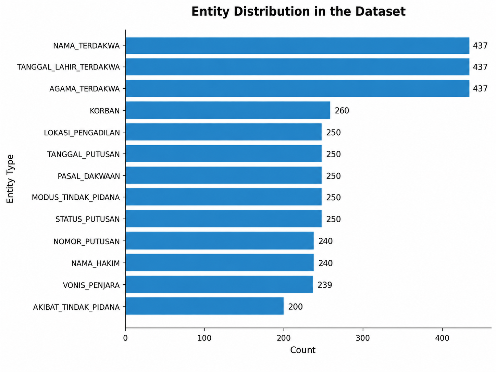
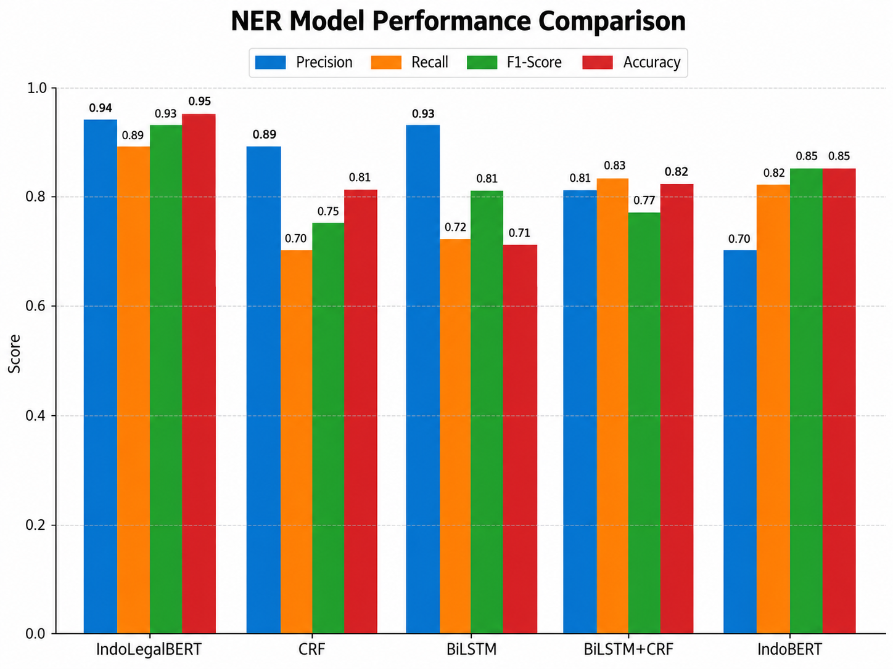
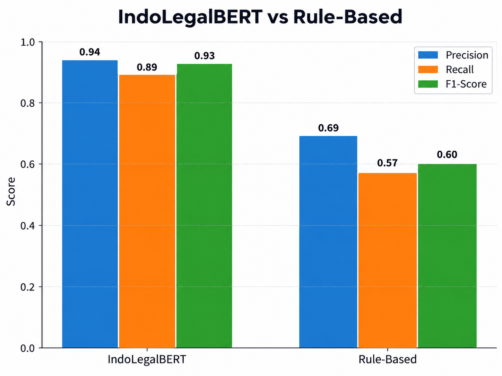

# Legal Judgment Information Extraction

Information extraction project for Indonesian criminal court decisions using **rule-based methods and Named Entity Recognition (NER)**.

The project compares traditional rule-based extraction with multiple sequence-labeling and transformer-based models to identify structured legal information from long, unstructured court-decision documents.

## Project Overview

The study used **250 criminal court decisions** collected from the repository of the Supreme Court of the Republic of Indonesia.

The documents were converted from PDF to text, cleaned, and manually annotated using **Label Studio** to create ground-truth data.

A total of **13 legal entity types** were extracted:

- Case Number
- Court Location
- Judge Name
- Decision Date
- Defendant Name
- Defendant Date of Birth
- Religion
- Charged Article
- Prison Sentence
- Decision Status
- Criminal Modus Operandi
- Victim
- Criminal Consequence

The study compared a **rule-based approach using Regular Expressions** with several NER architectures.

## Modeling Approaches

### Rule-Based Extraction

Regular expressions and predefined extraction rules were used to identify legal entities with relatively stable textual patterns.

The rule-based approach performed particularly well for structured entities such as charged articles, dates of birth, judge names, and religion, but showed weaker performance on narrative entities such as modus operandi and consequences.

### Named Entity Recognition

Five NER models were compared:

- Conditional Random Field (CRF)
- Bidirectional LSTM
- BiLSTM-CRF
- IndoBERT
- IndoLegalBERT

The models were evaluated using precision, recall, F1-score, and accuracy.

## Model Comparison

| Model | Precision | Recall | F1-Score | Accuracy |
|---|---:|---:|---:|---:|
| **IndoLegalBERT** | **0.94** | **0.89** | **0.93** | **0.95** |
| CRF | 0.89 | 0.70 | 0.75 | 0.81 |
| BiLSTM | 0.93 | 0.72 | 0.81 | 0.71 |
| BiLSTM-CRF | 0.81 | 0.83 | 0.77 | 0.82 |
| IndoBERT | 0.70 | 0.82 | 0.85 | 0.85 |

Based on the reported study results, **IndoLegalBERT achieved the strongest overall performance** among the evaluated NER architectures.

## Field-Level Evaluation

The selected model was further evaluated against manually prepared ground truth across the 13 legal entity types.

Overall field-level performance:

| Metric | Score |
|---|---:|
| Precision | 0.9175 |
| Recall | 0.9151 |
| F1-Score | 0.9160 |


Performance varied across entity types. Structured entities such as religion, charged articles, case numbers, and judge names achieved high F1-scores, while more ambiguous or narrative entities remained more difficult to extract consistently.

## Rule-Based vs Transformer-Based Extraction

At the aggregate level, the study reported:

| Method | Precision | Recall | F1-Score |
|---|---:|---:|---:|
| **IndoLegalBERT** | **0.94** | **0.89** | **0.93** |
| Rule-Based | 0.69 | 0.57 | 0.60 |

The results highlight the complementary strengths of both approaches: rule-based extraction works well for highly structured patterns, while contextual NER models are more suitable for varied and narrative legal language.

## Results Visualization

### Entity Distribution
The annotated dataset contains 13 legal entity types with an uneven class distribution across the dataset.



### NER Model Performance Comparison
IndoLegalBERT achieved the strongest overall performance among the evaluated NER models.



### IndoLegalBERT vs Rule-Based Extraction
The transformer-based approach achieved stronger aggregate performance, while the rule-based method remained competitive for entities with stable and predictable textual patterns.



## Key Challenges

The project identified several challenges in legal information extraction:

- inconsistent document structure;
- OCR-related noise;
- class imbalance;
- boundary errors in long narrative entities;
- long-context limitations;
- variation in legal writing styles.

Error analysis showed that long narrative entities such as criminal modus operandi and consequences were particularly challenging because their boundaries and contextual dependencies were more complex.

## Repository Contents

```text
legal-judgment-information-extraction/
├── README.md
├── transformer_ner_public.ipynb
├── baseline_ner_models_public.ipynb
├── rule_based_extraction_public.ipynb
├── model_vs_ground_truth_public.ipynb
└── requirements.txt
```

## Tools & Technologies

- Python
- Pandas
- PyTorch
- Hugging Face Transformers
- IndoBERT
- IndoLegalBERT
- CRF
- BiLSTM
- BiLSTM-CRF
- Regular Expressions
- Scikit-learn
- Seqeval
- Label Studio

## Notes

This repository contains a portfolio version of the original academic project.

Raw court documents, manually annotated datasets, local file paths, case-level records, and trained model artifacts are intentionally excluded from the public repository.
